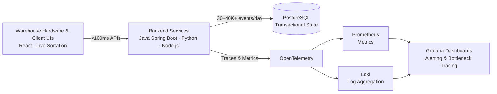
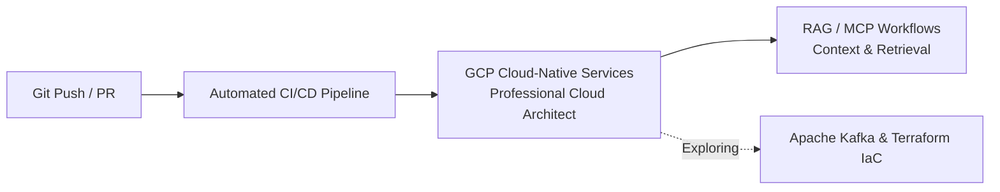
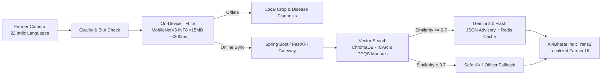

# Hi, I'm Saish Chaskar 👋

[LinkedIn](https://www.google.com/search?q=https%3A%2F%2Fwww.linkedin.com%2Fin%2Fsaish-chaskar%2F) [Twitter](https://www.google.com/search?q=https%3A%2F%2Ftwitter.com%2FSaishChaskar) [Instagram](https://www.google.com/search?q=https%3A%2F%2Fwww.instagram.com%2Fsaishchaskar%2F%3Figshid%3DOGQ5ZDc2ODk2ZA%253D%253D)

### Full-Stack Software Engineer · GCP Certified Cloud Architect

> *Building reliable web platforms, backend data services, and observable infrastructure.*

---

## About Me

I’m a **Software Development Engineer** working across the full stack—from browser interfaces and backend APIs to bare-metal observability. Currently, I build software for warehouse automation and live sortation systems at **Unbox Robotics**.

Working close to production hardware has shaped how I write code: writing a feature is only part of the job; making sure it behaves predictably under load and tells you when something breaks is what makes it dependable.

- **Backend & Real-Time Systems:** Build low-latency APIs (**<100ms**) and event-driven services processing **30–40K+ events/day** across **Java (Spring Boot)**, **Python**, **Node.js**, and **PostgreSQL**.
- **Cloud & Infrastructure:** **GCP Professional Cloud Architect** focused on cloud-native architectures, automated CI/CD pipelines, and practical **RAG / MCP** workflows.
- **Observability & Reliability:** Deploy and tune bare-metal monitoring stacks using **Grafana**, **Prometheus**, **Loki**, and **OpenTelemetry** to trace bottlenecks and prevent production incidents.
- **Currently Exploring:** Distributed System Design, **Apache Kafka**, and **Terraform (IaC)**.
- **Selected Builds:** End-to-end systems including **AgroConnect PWA**, **ResumeMetrics**, and **PetroConnect**.
- **Developer Community:** Regular attendee and builder at **GDG Pune**, **Cloud Native Pune**, and **JS Pune** meetups, and hackathons like **MumbaiHacks**.

---

## Architecture & Engineering Workflows

### 1. Real-Time Backend & Bare-Metal Observability Flow

### 2. Cloud-Native, CI/CD & RAG / MCP Workflow

### 3. Hybrid Edge-AI & Guardrailed RAG Flow (AgroConnect PWA)

---

## Project Highlights

| Project | Highlights & Architecture | Core Stack | Repository |
| :--- | :--- | :--- | :--- |
| **AgroConnect PWA** | Offline-first AgriTech platform for **450+ Indian crop diseases & pests** combining on-device **TFLite (<300ms)** inference with a **guardrailed RAG** pipeline (similarity ≥ 0.7 + KVK fallback) and **22 Indic languages**. | Angular · Java 21 · Spring Boot · TFLite · Gemini 2.0 Flash · ChromaDB · Redis · IndicTrans2 | [saishchaskar/agroconnect-pwa](https://www.google.com/search?q=https%3A%2F%2Fgithub.com%2Fsaishchaskar%2Fagroconnect-pwa) |
| **AgroConnect (Android)** | Earlier native Android implementation delivering **data.gov.in (OGD)** market prices, weather updates, and Firebase authentication. | Java · Android Studio (MVVM) · Firebase | [saishchaskar/Shetkari](https://github.com/saishchaskar/Shetkari) |
| **ResumeMetrics** | End-to-end system build. *[Add 1–2 line summary of workflow & key metrics]* | *[Add stack]* | [saishchaskar/resume-metrics](https://github.com/saishchaskar/resume-metrics) |
| **PetroConnect** | End-to-end system build. *[Add 1–2 line summary of workflow & key metrics]* | *[Add stack]* | *[Add repo link]* |

---
